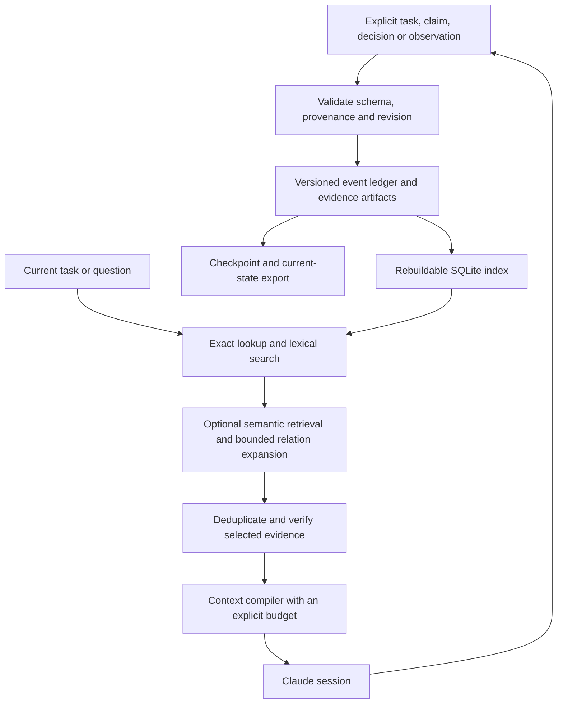

# research_OS: memory, context, and performance review

> Historical baseline review. The subsequent v2 implementation and measured changes are documented in [IMPLEMENTED.md](IMPLEMENTED.md). Statements about the unchanged runtime below describe the original review, before implementation.

Research date: **3 November 2026, Asia/Kolkata**. Baseline: `09951bf9d4acdc4def9332d6b7ec86736c21b9b3`.

**Recommendation: evolve research_OS into a local, evidence-aware memory system with a small context compiler, indexed retrieval, and measured quality gates. Keep its explicit claims and provenance. Introduce expensive semantic processing only where experiments show it helps.**

The current repository is a good small-project ledger and session handoff mechanism. It is not yet a state-of-the-art memory system: it cannot search its own records through the CLI, manage temporal revisions explicitly, select context for a particular task, enforce an overall context budget, or measure memory usefulness. Some integrity and handoff behaviors also need repair before scaling it.

This review includes the entire README, the 353-line runtime, installer, contract, hooks, all five bundled skills, design/extension documentation, and the existing tests. I ran the six tests successfully and added a reproducible audit using temporary projects. External research covers memory architectures, information retrieval, compression, caching, temporal knowledge, evaluation, storage, and memory poisoning. This is a targeted primary-source review, not an exhaustive systematic review or a reproduction of published model benchmarks.

The runtime has **not** been upgraded by this review. The new files are research artifacts, a reproducible baseline audit, and an implementation specification. No installed Claude configuration was changed. Published performance claims below are authors' results, not measurements of research_OS.

## What to preserve

- Explicit `verified`, `reported`, `hypothesis`, `disputed`, and other epistemic states.
- Evidence paths and content hashes, with the honest distinction between identity and correctness.
- A single validated write interface, local operation, and readable portable artifacts.
- Structured tasks, decisions, attribution, dependencies, and handoffs.
- A short working contract and procedures loaded on demand.
- No transcript collection by default and no model API requirement for bookkeeping.

These are valuable foundations for scientific work. A memory service that improves recall while silently merging conflicting results would be a regression for this project.

## Measured findings in the current code

Evidence: [audit program](audit_baseline.py) and [raw results](baseline_results.json). Every code reference below is to the baseline commit; line numbers will change after implementation.

| Priority | Finding and evidence | Consequence and recommended change |
|---|---|---|
| P0 | Handoff evidence is put in the event but omitted from the handoff record. `evidence_drift()` only visits tasks, claims, and decisions. A changed handoff-only evidence file produces `OK`. [Code](https://github.com/devharish1371/research_OS/blob/09951bf9d4acdc4def9332d6b7ec86736c21b9b3/template/project_ops/projectctl.py#L342) | Preserve handoff references and define verification coverage for notes, current records, and historical events. Include evidence IDs in resumable context. |
| P0 | A changed claim file prints `DRIFT ...` followed by `OK`, exiting 0. The existing test explicitly accepts this. [Code](https://github.com/devharish1371/research_OS/blob/09951bf9d4acdc4def9332d6b7ec86736c21b9b3/template/project_ops/projectctl.py#L293) | Automation cannot distinguish clean evidence from stale evidence. Define separate machine-readable integrity and freshness results and a strict failure mode; migrate the documented default deliberately. |
| P0 | An existing verified claim accepts entirely new wording while retaining its old evidence, even if that evidence has drifted. [Code](https://github.com/devharish1371/research_OS/blob/09951bf9d4acdc4def9332d6b7ec86736c21b9b3/template/project_ops/projectctl.py#L325) | A semantic change must create a revision and invalidate its verification until evidence is reviewed for the new wording. File existence alone cannot establish entailment. |
| P0 | An empty, existing journal passes verification. `status` also emits manually modified state that a separate `verify` correctly rejects. [Code](https://github.com/devharish1371/research_OS/blob/09951bf9d4acdc4def9332d6b7ec86736c21b9b3/template/project_ops/projectctl.py#L95) | Reject empty history for initialized state. Check integrity before injecting memory, with an explicit integrity-warning fallback. A startup summary must not silently promote corrupted state. |
| P0 | After Stop blocks, the assistant records a handoff and the retry has `stop_hook_active=true`; the marker is never refreshed. A subsequent edit without a new handoff is missed. Reproduced across two simulated turns. [Code](https://github.com/devharish1371/research_OS/blob/09951bf9d4acdc4def9332d6b7ec86736c21b9b3/template/project_ops/projectctl.py#L243) | Maintain an acknowledged work/handoff revision. The loop-prevention flag should suppress another block, not discard all bookkeeping. Test multiple turns, resume, and compaction. |
| P1 | Startup summary has no aggregate size limit. Every blocked task and every disputed/unknown claim is emitted; drift paths are unbounded. Only ready tasks have a count cap. [Code](https://github.com/devharish1371/research_OS/blob/09951bf9d4acdc4def9332d6b7ec86736c21b9b3/template/project_ops/projectctl.py#L194) | Build a budgeted, deterministic context packet. Include counts and retrieval pointers for omitted records. Bound every field and every collection. |
| P1 | The same evidence file is hashed once per reference. A fixture with 100 references to one file produced 100 hashes. [Code](https://github.com/devharish1371/research_OS/blob/09951bf9d4acdc4def9332d6b7ec86736c21b9b3/template/project_ops/projectctl.py#L176) | Deduplicate hashing within a check and maintain a file-to-dependent-record index. Use cached checks for routine status and explicit complete checks for audits. |
| P1 | Fingerprinting rereads small files on startup and Stop, ignores files at or above 1 MiB, skips every directory called `logs`, and follows file symlinks outside the project. The latter two fixture behaviors were directly reproduced for size and symlinks. [Code](https://github.com/devharish1371/research_OS/blob/09951bf9d4acdc4def9332d6b7ec86736c21b9b3/template/project_ops/projectctl.py#L211) | Use configured paths and incremental change detection. Bound bytes/time, not only accepted file count. Reject external symlinks. Mark incomplete scans as incomplete, not unchanged. |
| P1 | Every write checks the entire journal, reads it again to find the tail, rewrites the entire state, and writes whole-state snapshots. [Code](https://github.com/devharish1371/research_OS/blob/09951bf9d4acdc4def9332d6b7ec86736c21b9b3/template/project_ops/projectctl.py#L134) | Use complete replayable events, checkpointed projections, and incremental indexes. Preserve v1 snapshots until replay equivalence is established. |
| P1 | Task ID sets are rebuilt for each dependency. Validation scales approximately quadratically for a chain of tasks. Self-dependency is accepted; a task can become done with an empty acceptance criterion. `validate()` itself does not require evidence for done tasks, although the normal CLI transition does. [Code](https://github.com/devharish1371/research_OS/blob/09951bf9d4acdc4def9332d6b7ec86736c21b9b3/template/project_ops/projectctl.py#L110) | Precompute maps, detect cycles, and centralize invariants. Preserve the difference between structural checks and actual acceptance review. |
| P1 | Notes live only in the journal; decisions are absent from normal status; there is no `search`, `show ID`, `history`, or temporal query command. [CLI](https://github.com/devharish1371/research_OS/blob/09951bf9d4acdc4def9332d6b7ec86736c21b9b3/template/project_ops/projectctl.py#L258) | Add bounded structured reads and searchable projections so useful stored information can actually be recalled. |
| P1 | Installer keeps an existing `.claude/settings.json` without merging hooks, or overwrites the entire file with `--force`. The same overwrite path applies to customized `CLAUDE.md`. [Installer](https://github.com/devharish1371/research_OS/blob/09951bf9d4acdc4def9332d6b7ec86736c21b9b3/install.sh#L19) | Provide an installation manifest, merge owned hook entries, show a dry-run diff, and support migrations/backups. Avoid treating force-overwrite as an upgrade strategy. This finding is from inspection. |

Additional inspection findings: no schema-version enforcement; no structured numeric-claim denominator/protocol fields despite the contract; no deletion/retention lifecycle; no session ownership for the global handoff; no consistent read lock across state/journal; no automatic crash recovery; and text filtering does not cover every field (for example the initial project goal). The credential regex is a heuristic, not a complete prevention mechanism. None of these findings implies that the hash chain was intended to resist an attacker rewriting the entire store—the README already states that limitation correctly.

### Synthetic scale measurements

Environment: macOS ARM64, Python 3.13.7. These are warm in-process timings and synthetic data. They do not measure hosted-model latency, real tokenization, production workload distributions, or peak process RAM.

| Blocked tasks | Startup summary characters | Rough characters/4 estimate, **not tokenized** |
|---:|---:|---:|
| 10 | 1,072 | 268 |
| 100 | 8,992 | 2,248 |
| 1,000 | 89,092 | 22,273 |
| 10,000 | 899,092 | 224,773 |

The repeated `x` fixture is deliberately a size stress test; its actual tokenizer behavior can differ greatly from ordinary prose. The reliable conclusion is **unbounded output growth**, not the estimated token count. Current Claude Code documentation caps each hook context string at 10,000 characters and replaces oversized content with a file pointer and a preview of up to 2,000 characters. Therefore these figures do **not** show that all this text reaches the model. They expose a risk of missing startup information; reading the overflow file adds work. A deliberate bounded packet is still necessary. [Hook output limits](https://code.claude.com/docs/en/hooks#json-output).

| Tasks in a dependency chain | Median validation time, 3 runs |
|---:|---:|
| 100 | 0.227 ms |
| 1,000 | 20.794 ms |
| 5,000 | 617.674 ms |

| Tasks added sequentially | Current state bytes | Stored snapshot bytes |
|---:|---:|---:|
| 25 | 6,635 | 91,303 |
| 50 | 12,885 | 338,428 |
| 100 | 25,386 | 1,301,429 |
| 200 | 50,486 | 5,107,579 |

At 200 additions, snapshots occupy about **101 times** the current state size. This is measured filesystem content before Git compression. For a workload adding constant-sized records, whole-state snapshots accumulate quadratically. The current summary events lack enough payload to reconstruct all state independently, so simply deleting snapshots or switching their frequency would weaken recovery.

Journal verification also materializes the whole history. In a separate synthetic valid-chain fixture, 1,000 events occupied 366,890 bytes on disk and caused 1,657,957 bytes of peak traced Python allocations; 10,000 events occupied 3,678,890 bytes and caused 16,699,653 bytes of peak traced allocations. These `tracemalloc` peaks are **not total process RSS**, and allocation instrumentation affects latency. Streaming verification would avoid retaining every decoded event simultaneously.

## What “memory efficiency” means here

There are four different budgets. Optimizing one does not guarantee improvement in the others.

| Budget | Relevant work in this repository | Measurement |
|---|---|---|
| Persistent knowledge | Records, events, evidence, revisions, retrieval quality | Recall, temporal correctness, provenance, update/delete correctness |
| Model context | Contract, tool descriptions, startup packet, retrieval results, conversation | Actual input/output/cached tokens per completed task |
| Local compute and storage | JSON parsing, hashing, indexing, snapshots, embedding model residency | p50/p95 time, bytes read, disk growth, peak RSS |
| Model-serving memory | Weights, KV cache, batching, inference kernels | VRAM, throughput and inference latency, only if you own serving |

The first three are directly actionable. PagedAttention improves serving allocation; Titans changes model-level memory. Neither is an installable fix to a Claude Code project ledger. They belong in a separate self-hosted-model workstream if that becomes a requirement. [PagedAttention paper](https://arxiv.org/abs/2309.06180), [Titans paper](https://arxiv.org/abs/2501.00663).

## Research findings and how they apply

### 1. Hierarchies and selective context are established foundations

MemGPT formalizes movement between immediate and external memory. Anthropic's context-engineering guidance emphasizes selective retrieval, compaction, and structured notes. The implication for this repository is to make the startup handoff one small working set, with deeper knowledge fetched when needed. [MemGPT](https://arxiv.org/abs/2310.08560), [context engineering](https://www.anthropic.com/research/effective-context-engineering-for-ai-agents).

Long context is an option to benchmark, not a substitute for information selection. Lost in the Middle demonstrated positional sensitivity on the models it evaluated; that 2023 result should not be presented as a universal quantitative claim about current models. Keep full-context and filesystem-search baselines in the evaluation. [Lost in the Middle](https://arxiv.org/abs/2307.03172).

Letta's filesystem study reports competitive LoCoMo performance and questions cross-system benchmark comparability. Its filesystem also uses parsed/embedded files and semantic search; describing the result as “plain grep beats everything” would be inaccurate. [Letta's experiment](https://www.letta.com/blog/benchmarking-ai-agent-memory/).

### 2. Retrieval quality matters more than how much is stored

Use exact record IDs, paths, metric names, model names, and dataset identifiers as first-class retrieval signals. Combine lexical search with semantic search only when paraphrase and associative queries justify it. Anthropic's Contextual Retrieval adds document context to chunks and combines lexical/dense retrieval with reranking. For this repo, cheap deterministic context—project, task, source title, section, date—should precede LLM-generated chunk enrichment. [Contextual Retrieval](https://www.anthropic.com/research/contextual-retrieval).

SQLite FTS5 supplies local full-text search and BM25 ranking. It is available in the Python/SQLite runtime checked here, but installers should probe availability on other machines. Start with structured SQL filters plus FTS5; retain a bounded filesystem-search fallback. [FTS5 documentation](https://www.sqlite.org/fts5.html).

An especially relevant recent preprint is **AgentMemRec, 26 October 2026**: candidate generation, a learned cheap ranker, and selection under a token budget. It emphasizes retrieving all evidence needed for a multi-session answer. Its main comparison uses a 209-question multi-session subset and a ranker trained on development labels; reported serving costs exclude shared candidate generation. This is promising design evidence, not proof of universal superiority. Adopt the evaluation idea now; evaluate a learned ranker later. [Paper and experimental setup](https://arxiv.org/html/2610.34673v1).

### 3. Temporal and relational memory should retain contradictions

Zep/Graphiti represents evolving knowledge with temporal structure. research_OS needs explicit links such as `supersedes`, `contradicts`, `depends_on`, and `supported_by`, plus both event time and recording time. A claim reported today about an experiment last month must not be mistaken for a new experiment. [Zep paper](https://arxiv.org/abs/2501.13956).

A-Mem develops linked structured notes. HippoRAG 2 studies associative retrieval using graph structure. These are relevant to a literature corpus or experiment lineage, but they do not establish that a graph database is the best first upgrade for a few hundred project records. Start with explicit edges in SQLite; expand to graph retrieval if a labeled multi-hop evaluation exposes a weakness. [A-Mem](https://arxiv.org/abs/2502.12110), [HippoRAG 2](https://arxiv.org/abs/2502.14802).

### 4. Compression must preserve the route back to evidence

SimpleMem combines structured compression, synthesis, and intent-aware retrieval. Its January 2026 paper reports substantial savings relative to full-context inference on its evaluated tasks. Its “semantic lossless” terminology is not a guarantee that a summary preserves every future-useful scientific detail. Store the original artifact, a short source-linked memory unit, and a regenerable summary. [SimpleMem v3](https://arxiv.org/html/2601.02553v3).

Mem0 extracts, consolidates, and retrieves conversational memories, with a graph variant. It is a useful external comparison. Its published latency/token reductions have specific baselines and do not predict savings against research_OS's already-small default handoff. [Mem0 paper](https://arxiv.org/abs/2504.19413).

LLMLingua-2 makes extractive prompt compression a learned token-classification problem. Evaluate such compression on bulky retrieved prose if needed; do not begin by compressing exact evidence, code, acceptance criteria, negations, units, or numerical denominators. Deterministic field selection and duplicate removal have lower integration cost. [LLMLingua-2](https://arxiv.org/abs/2403.12968).

### 5. Memory should improve procedures without rewriting history

ACE addresses information loss from repeatedly rewriting a monolithic context, using incremental updates to a playbook. Apply that idea to versioned procedures: record which approach worked, under what conditions, and which outcome supports it. Keep detailed lessons in topic files and retrieve only the applicable ones. Do not continually enlarge the always-loaded contract. [ACE](https://arxiv.org/html/2510.04618v1).

Hindsight distinguishes world facts, agent experiences, entity summaries, and beliefs, with retain/recall/reflect operations. That distinction fits this repository's epistemic discipline: an inferred lesson should remain separate from an observed result. A reflection should be a proposed, source-linked record until validated. [Hindsight paper](https://arxiv.org/abs/2512.12818).

Memory-R1 trains memory operations with reinforcement learning. The August 2026 Hindsight Memory-PRM paper explores learning memory utility from auditable retrieval/citation traces and interventions; it is a separate research effort from the Hindsight framework above. Both are advanced experiments after a stable task distribution and evaluation set exist, not prerequisites for an efficient local tool. [Memory-R1](https://arxiv.org/abs/2508.19828), [Memory-PRM](https://arxiv.org/abs/2608.29605).

### 6. Large-corpus analysis and durable project memory are separate capabilities

Recursive Language Models treat long inputs as an external environment that a model can inspect and decompose programmatically. That suggests a useful optional analysis path for large paper collections or logs. Persist only the findings and source references into project memory. Recursion itself does not solve reliable updates, deletion, provenance, or session handoff. [RLM paper](https://arxiv.org/abs/2512.24601).

MemOS broadens the resource-management view across textual, activation, and parameter memory, with metadata and versioning. Adopt its lifecycle perspective where it matches this repo; its full scope is much larger than a local CLI wrapper. [MemOS](https://arxiv.org/abs/2507.03724).

### 7. Tool output and caching are part of memory engineering

Filter and aggregate large outputs in code before returning them to the model. Return a compact result, provenance, and a handle to the full artifact. Tool schema loading and intermediate tool output can themselves dominate context costs. [Anthropic's tool execution analysis](https://www.anthropic.com/research/code-execution-with-mcp).

Claude Code already manages prompt caching. Keep the contract stable; return changing task state as small context/tool results; measure cache reads, cache writes, and uncached tokens separately. Caching lowers repeated processing cost but does not remove context-window occupancy or irrelevant material. Avoid claiming that every disk edit breaks the prefix: current docs say repository reads append to the conversation, and root instruction changes load at session boundaries. [Claude Code caching](https://code.claude.com/docs/en/prompt-caching).

### 8. Native harness memory must not become a competing authority

Claude Code currently distinguishes instruction files from auto memory, with bounded loading for the latter and on-demand topic files. Use native memory for preferences, navigation, and a pointer to the ledger. Mutable research facts should have one authoritative owner. Imports organize instruction files but do not make imported content free of context cost. [Claude Code memory](https://code.claude.com/docs/en/memory).

The README's statement that skills cost no context until used is too strong: skill bodies are on demand, while discovery metadata still has context cost. Keep descriptions concise. [Skills documentation](https://code.claude.com/docs/en/skills).

Pin and test harness behavior. Current hooks include compaction-related events, but a hook that never reads the conversation cannot recover unrecorded reasoning. A compaction checkpoint should save existing structured state; it should not claim to have captured facts that were never written. Transcript-based extraction would be a separate opt-in design change. [Hooks reference](https://code.claude.com/docs/en/hooks).

### 9. Evaluate remembered actions, not only remembered answers

LongMemEval covers extraction, multi-session reasoning, temporal reasoning, updates, and abstention. LoCoMo provides long conversational-memory tasks. Mem2ActBench tests whether memory supports tool choice and parameter grounding. The last is particularly relevant to resuming experiments with the right protocol, file, seed, and dataset. [LongMemEval](https://arxiv.org/abs/2410.10813), [LoCoMo](https://arxiv.org/abs/2402.17753), [Mem2ActBench](https://arxiv.org/abs/2601.19935).

A vendor's score can vary with the answer model, judge, benchmark subset, evidence made available, and retrieval budget. Comparing accuracy across different setups cannot establish a best memory engine for this project. Use fixed models and identical budgets in your own evaluation. The broader memory literature also identifies evaluation and lifecycle control as central open issues. [Memory survey](https://arxiv.org/abs/2603.07670).

### 10. Provenance and deletion are functional requirements

MINJA demonstrates that adversarial content can persist through a memory-writing pipeline. Retrieved information should retain its origin and trust classification; it cannot authorize actions. Keep source text separate from instructions, and test whether hostile documents can become trusted rules after extraction or summarization. [MINJA](https://arxiv.org/abs/2503.03704).

Forgetting also requires precision. Excluding a record from search is different from erasing it from events, snapshots, embeddings, backups, and Git history. Define retention and deletion guarantees before storing private material. A hash chain that permanently embeds plaintext conflicts with full erasure; a v2 design should distinguish immutable audit metadata from removable content.

## Recommended setup

The best fit is a **local core with optional retrieval and learning extensions**. “State of the art” should mean the strongest measured quality/cost tradeoff on your workload, not the largest dependency stack.

### Memory layers

| Layer | Content | Loading rule |
|---|---|---|
| Contract | Authority, evidence rules, essential commands | Small stable file; loaded at session start |
| Working state | Active task, acceptance, blockers, current handoff, critical constraints | Bounded startup packet and task-specific refresh |
| Episodic records | What was tried, results, failures, environment and source pointers | Search by task/date/artifact |
| Semantic records | Scoped facts, claims, entity identifiers, conflicts | Retrieve by question with temporal/status filters |
| Procedural records | Versioned methods, failure avoidance, reusable lessons | On-demand skill or topic file |
| Evidence archive | Original outputs, source versions, protocols, papers | Read exact spans when needed; never blindly preloaded |

This taxonomy is a design proposal, not a requirement for six independent databases. Use a single record model with types and typed links.

### Initial context budgets

These are proposed starting values to tune, **not measured optima**:

| Item | Proposed target |
|---|---|
| Working contract | Approximately 500–800 model tokens |
| Startup working state | At most 1,200 model tokens |
| Ordinary task retrieval | At most 3,000 model tokens |
| Deeper evidence retrieval | Explicit expansion up to 8,000 tokens when needed |
| Large tool results | Short structured summary plus artifact handle; configurable byte cap |

Count with the actual model tokenizer/provider count facility where available. If it is unavailable, enforce a hard UTF-8 byte cap and explicitly label tokens as estimated. A characters/4 estimate is not a guaranteed token ceiling. Include omission counts, integrity/freshness status, and commands to fetch details. If mandatory constraints cannot fit, report that limitation instead of silently dropping them.

Reserve space for answers and tool results. A retrieval budget is not the model's total context budget. The user's active request and hard constraints must survive even when optional memories are removed.

### Retrieval policy

1. Resolve project, branch/worktree scope, task IDs, time range, and exact identifiers.
2. Retrieve active applicable constraints and exact records before fuzzy search.
3. Fetch a bounded lexical candidate set from SQLite FTS5.
4. Optionally add dense candidates for paraphrases; fuse ranks and deduplicate record revisions.
5. Expand explicit evidence/dependency/conflict links within bounded hops and candidate counts.
6. Prefer relevant, source-supported, current records; include opposing evidence for disputed claims. Do not let recency alone suppress an older valid result.
7. Verify the selected evidence or surface its unverified/stale condition.
8. Assemble a packet under the budget, preserving multi-record evidence needed to answer.
9. If evidence is insufficient, perform a bounded follow-up or return uncertainty. Log the retrieval path for evaluation.

The initial implementation should require **zero extra LLM calls** for status, indexing explicitly recorded data, or lexical retrieval. LLM extraction from new literature and optional synthesis can be asynchronous and explicitly budgeted. Embedding/reranking costs still count even if no generative LLM is called.

### Storage and runtime policy

Use complete versioned events as the portable authoritative history; use SQLite as a rebuildable materialized view and search index. Keep `state.json` as a compatibility/export view during migration. The existing event schema is insufficient for independent replay, so this is a schema migration, not a filename change.

Write only changed records/events; checkpoint by event count or log size; stream historical verification. Deduplicate evidence hashing; cache routine freshness using size, nanosecond mtime and filesystem identity, while stating that metadata caching is not cryptographic verification. Fully hash selected evidence before consequential reliance and provide a full audit command.

Local SQLite WAL can improve reader/writer concurrency, but it still has a single writer and does not turn a repository into a distributed database. Do not share its live WAL database over a network filesystem. Keep generated indexes out of Git and rebuild them on clone. [SQLite WAL](https://www.sqlite.org/wal.html).

For multiple writers, use separate work branches or a serialized write service, stable IDs, expected revisions, and explicit conflict events. An arbitrary text merge or last-writer-wins rule is unsuitable for contradictory scientific claims.

## Build versus adopt

| Option | Fit here | Recommendation |
|---|---|---|
| Native Claude memory + current ledger | Small projects; least setup | Keep as a comparison baseline, fix integrity and startup limits |
| research_OS + SQLite FTS5 + context compiler | Auditable project work; local operation; low routine overhead | **Default direction** |
| Optional embeddings and reranker | Paraphrases, larger paper collections, semantic misses | Add only after measured retrieval gaps |
| Graphiti | Entity-rich temporal relations across large evolving sources | Pilot when explicit relational retrieval is insufficient; introduces a graph backend and model-dependent ingestion [repository](https://github.com/getzep/graphiti) |
| Hindsight | General retain/recall/reflect service and memory experiments | Strong evaluation candidate if a service/embedded runtime and model calls are acceptable [repository](https://github.com/vectorize-io/hindsight) |
| SimpleMem | Compressed conversational/multimodal memory | Comparative experimental adapter; inspect current dependencies and API requirements [repository](https://github.com/aiming-lab/SimpleMem) |
| Mem0 | Application-facing conversational memory | Comparative adapter, retaining research_OS as evidence authority [paper](https://arxiv.org/abs/2504.19413) |
| Learned rankers / RL memory policy | Sufficient labeled or feedback-rich workloads | Later experiment with held-out evaluation and rollback |

Do not install multiple competing memory writers into the same project. Evaluate candidates behind one read/write contract and preserve provenance across adapters. A local extension should remain usable when the embedding model, network, or optional service is unavailable.

## Execution order and acceptance gates

| Stage | Deliverable | Gate before moving on |
|---|---|---|
| 1. Correctness | Fix evidence coverage, strict verification semantics, verified-claim revisions, empty-journal handling, multi-turn Stop markers, schema/dependency validation | Regression cases from this audit pass; interrupted-write and concurrent-reader fixtures behave predictably |
| 2. Context and local performance | Bounded packet, `show/search/history`, deduplicated hashing, incremental change detection, precomputed dependency maps | Every packet respects the configured cap; growth tests at 10k records; measured p95 on reference hardware |
| 3. Lifecycle and storage | Versioned replayable events, SQLite projection, checkpoints, migration, temporal links, archival/deletion policy | Replay equals exported state; rebuild succeeds; crash injection at each write boundary; v1 backup remains recoverable |
| 4. Retrieval evaluation | Exact/lexical baseline, optional semantic adapter, retrieval diagnostics, project-specific benchmark | Same-model comparison shows useful improvement without critical regressions |
| 5. Expansion | Literature ingestion, reusable procedure learning, optional external memory adapter | Improves successful-task cost/latency or quality on held-out tasks; rollback and attribution remain intact |

Suggested initial performance goals, subject to measurement: warm routine startup p95 below 250 ms and lexical retrieval p95 below 100 ms on an agreed 10k-record laptop fixture. Cold startup, full audits, large evidence files, and semantic model initialization need separate budgets. These are engineering targets, not promises or results already achieved.

## Evaluation required before calling the setup state of the art

Build a frozen, versioned suite of **120 project-specific scenarios**, initially 12 in each category: resume, exact facts, revisions/supersession, temporal questions, multi-evidence reasoning, contradictions, abstention, procedure reuse, evidence drift, and hostile/foreign-scope records. Use realistic synthetic fixtures first, then opt-in sanitized project traces. Separate development and held-out test projects; do not tune against the final set.

Compare: no persisted memory; native harness memory/filesystem search; current research_OS; corrected bounded research_OS; lexical index; hybrid retrieval; optional graph/learned variants. Hold the answer model, reasoning effort, tools, task prompts, corpus, and retrieval budget fixed. Include repeated trials for stochastic agent behavior and paired uncertainty intervals; inspect critical failures manually.

Measure:

- Final task success and tool-argument correctness, not just retrieval overlap.
- Evidence precision, recall, and whether **all required evidence** fits in the selected packet.
- Current-versus-historical answer accuracy and correction/abstention behavior.
- Critical-constraint retention across handoffs and compaction.
- Input, output, cache-read, cache-write, embedding, extraction, reranking, and synthesis cost.
- p50/p95 end-to-end time, startup time, search time, bytes hashed, peak RSS, and disk growth.
- Stale-evidence use, cross-project leakage, and whether deletion removes a record from every advertised retrieval surface.

A candidate advances if it materially improves task success, or reduces total cost/latency without a meaningful quality loss, and has zero failures on deterministic critical invariants. Pre-register a non-inferiority margin for stochastic quality instead of choosing it after results. Report Pareto tradeoffs rather than collapsing everything into an unexplained score.

An illustrative cost model is:

`total = ingestion + indexing + extraction + retrieval/reranking + answering + consolidation + infrastructure`

For a paid extraction cost W and a measured saving S per later query, amortization needs more than W/S useful queries when S is positive. Fewer retrieved tokens can still cost more if every memory write or query adds expensive model calls. No savings percentage can be honestly predicted here without usage traces and fixed model pricing.

## Recommended decision

Proceed with stages 1–3 as the core redesign and make evaluation part of the implementation from the start. Preserve the research integrity model; strengthen retrieval and lifecycle control around it. Evaluate hybrid retrieval and an external memory engine only after the corrected local baseline exists.

The most valuable extension is **a reliable context compiler over versioned, evidence-linked records**. That directly addresses the observed bloat, forgotten decisions, stale claims, and repeated work while preserving the repository's portability. A state-of-the-art claim should follow the benchmark, not precede it.

The companion [implementation specification](IMPLEMENTATION_SPEC.md) defines the proposed schema, commands, migration, and regression gates. The [source register](SOURCES.md) records sources and reading depth.
